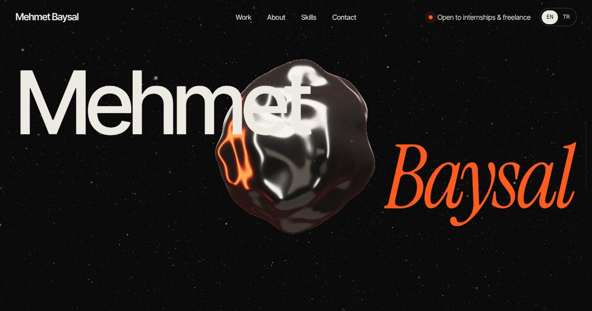

# Mehmet Baysal — Portfolyo

Web geliştirici ve Burdur Mehmet Akif Ersoy Üniversitesi Web Tasarımı ve Kodlama öğrencisi Mehmet Baysal'ın kişisel portfolyosu. Kaydırdıkça şekil değiştiren gerçek zamanlı bir 3D sahne üzerine kurulu, iki dilli (TR / EN).
Personal portfolio of Mehmet Baysal, web developer and Web Design & Coding student, built around a real-time 3D scene that transforms as you scroll.

**Canlı site:** https://baysai.github.io/baysal-portfolio/ · [LinkedIn](https://www.linkedin.com/in/mehmet-baysal-44b946376) · mehmetbaysalweb@gmail.com · [CV (PDF)](public/Mehmet_Baysal_CV.pdf)

## Sitedeki projeler

Commit sayısına göre sıralı:

| Proje                                                                          | Ne                                                                                                   | Commit | Teknolojiler                     |
| ------------------------------------------------------------------------------ | ---------------------------------------------------------------------------------------------------- | -----: | -------------------------------- |
| [Almost There](https://github.com/baysaI/almost-there)                         | [itch.io](https://mehmetbaysal.itch.io/almost-there)'da yayında, PS1 tarzı korku oyunu (~100 oyuncu) |    429 | Three.js, GLSL, Web Audio        |
| [Cypilan](https://github.com/baysaI/cypilan)                                   | Kıbrıs için beş dilli ilan pazaryeri                                                                 |    299 | Node.js, Express, EJS, SQLite    |
| Dağıtım Takip Sistemi                                                          | Oteller ve işletmeler için dağıtım ve stok takibi                                                    |     62 | Node.js, Express, SQLite         |
| [Okuryazmaz](https://github.com/baysaI/okuryazmaz)                             | Edebiyat ve kitap forumu                                                                             |     36 | Node.js, Express, SQLite, Gemini |
| [Boru Hattı Analiz Paneli](https://github.com/baysaI/BoruHattiAnalizKodlamasi) | TÜBİTAK başvurusu için sensör izleme paneli (ön elemeyi geçti)                                       |     12 | Bootstrap, jQuery, Chart.js      |

Ekran görüntüleri projeler çalıştırılarak alındı ve `public/projects/` altında duruyor.

## Deneyim · Experience

- **Serbest Web Geliştirici — Altuncu Premium Termal Otel (Mar 2026):** [altuncupremium.com.tr](https://altuncupremium.com.tr) framework'süz HTML, CSS ve JavaScript ile sıfırdan geliştirilip yayına alındı.
- **Google İşletme Profili & QR menü:** Altuncu Premium Termal Otel, Altuncu Cafe ve Dark Blue Cafe (Manisa).
- **Turizm ve otelcilik (2021 – 2024):** Liberty Lara (Antalya), İskele Park Termal (Armutlu/Yalova).
- **Eğitim:** Burdur Mehmet Akif Ersoy Üniversitesi, Web Tasarımı ve Kodlama (önlisans, 2025 – 2027).
- **Sertifikalar:** BTK Akademi — 7 sertifika (2025 – 2026).



## Öne çıkanlar · Highlights

- **Sıvı chrome heykel:** GPU'da simplex noise ile deforme edilen icosphere. Normaller her vertex'te yeniden hesaplanır, prosedürel stüdyo ışıklarını (PMREM) yansıtır. Fare yüzeye değdiğinde halka dalgalar oluşur.
- **Parçacık morph sistemi:** 26.000'e kadar parçacık kaydırmayla anlamlı formlar arasında dönüşür: tarayıcı penceresi, gerçek commit verisinden 3D aktivite haritası, her projenin kendi cihaz çerçevesindeki ekranı (renkler ekran görüntüsünden), projelerin git dal grafiği ve imza. Proje ekranlarında parçacıklar net ekran görüntüsüne dönüşür.
- **Scroll director:** Her bölüm canlı ScrollTrigger konumlarına bağlı keyframe'lerle 3D sahne durumuna eşlenir; easing ve sönümleme ile sinematik bir his verir.
- **Post-processing:** Bloom, kaydırma hızına duyarlı kromatik sapma, vinyet, film greni.
- **Etkileşim:** Lenis smooth scroll, menü linklerinde bölüm perdesiyle geçiş, pinlenmiş proje sahnesi, yatay süreç akışı, hıza duyarlı marquee, manyetik butonlar, özel imleç, kelime kelime metin animasyonları.
- **Performans:** three.js ayrı chunk olarak preloader sırasında yüklenir, cihaz seviyesine göre kalite (high / medium / low), FPS düşerse otomatik çözünürlük azaltma, ekran kapalıyken render durdurma.
- **Erişilebilirlik:** `prefers-reduced-motion` desteği, klavye odak stilleri, skip link, WebGL yoksa CSS chrome küre yedeği, JavaScript olmadan da okunabilen HTML.
- **SEO:** İçerik build sırasında HTML'e gömülür, Open Graph görseli, JSON-LD.

## Teknolojiler · Stack

Vite · TypeScript · Three.js · GLSL · GSAP (ScrollTrigger) · Lenis · Fontsource (Inter Tight, Instrument Serif, Geist Mono)

## Başlangıç · Getting started

```bash
npm install
npm run dev        # http://localhost:5173
npm run build      # dist/ klasörüne üretim build'i
npm run preview    # build'i yerelde önizle
npm run typecheck
npm run format
```

Node.js 20+ önerilir.

## İçeriği düzenleme · Editing content

Tüm içerik tek yerde toplanmıştır — HTML'e dokunmanız gerekmez:

| Dosya                     | Ne içerir                                                                      |
| ------------------------- | ------------------------------------------------------------------------------ |
| `src/content/site.ts`     | İsim, e-posta, projeler (görsel, cihaz, commit), istatistikler                 |
| `src/content/activity.ts` | Repolardan çıkarılan günlük ve haftalık commit verisi                          |
| `src/content/i18n.ts`     | Tüm metinler (EN + TR). `<em>` ile vurgulu italik kelimeler eklenebilir        |
| `src/styles/tokens.css`   | Renkler, tipografi ölçeği, boşluklar, animasyon eğrileri                       |
| `src/webgl/shapes.ts`     | Parçacık formları (tarayıcı, aktivite haritası, cihaz ekranları, grafik, imza) |
| `src/webgl/director.ts`   | Hangi bölümde 3D sahnenin nasıl görüneceği                                     |

Yeni bir proje eklemek için `public/projects/` içine ekran görüntüsünü koymak, `site.ts` içindeki `projects` listesine bir satır (görsel, cihaz türü, commit sayısı) ve `i18n.ts` içine TR ve EN metinlerini eklemek yeterli; 3D ekran ve çerçeve otomatik oluşur.

Dil seçimi sırasıyla `?lang=tr` parametresi → kayıtlı tercih → tarayıcı dili ile belirlenir.

## Mimari · Architecture

```
src/
  app.ts              boot sırası: metin → scroll → arayüz → 3D → preloader → intro
  content/            site verisi, çeviriler, build-time HTML parçaları
  core/               cihaz algılama, Lenis + ScrollTrigger, pointer, performans
  ui/                 header, preloader, imleç, reveal'lar, iş/süreç/marquee bölümleri
  webgl/              stage, ortam ışığı, heykel, parçacıklar, post-processing, director
build/html-content.ts Vite eklentisi: metinleri ve tekrarlanan blokları HTML'e gömer
```

## Yayına alma · Deployment

`main` dalına her push'ta `.github/workflows/deploy.yml` siteyi GitHub Pages'e yayınlar.
İlk seferde repo ayarlarından **Settings → Pages → Source: GitHub Actions** seçilmelidir.
`vite.config.ts` göreli `base: './'` kullandığı için build herhangi bir statik hosting'de (Netlify, Vercel, Cloudflare Pages) de çalışır.

## Lisans

Kod: MIT. Simplex noise: Ashima Arts (MIT, bkz. `THIRD_PARTY_NOTICES.md`). Fontlar: SIL Open Font License.
